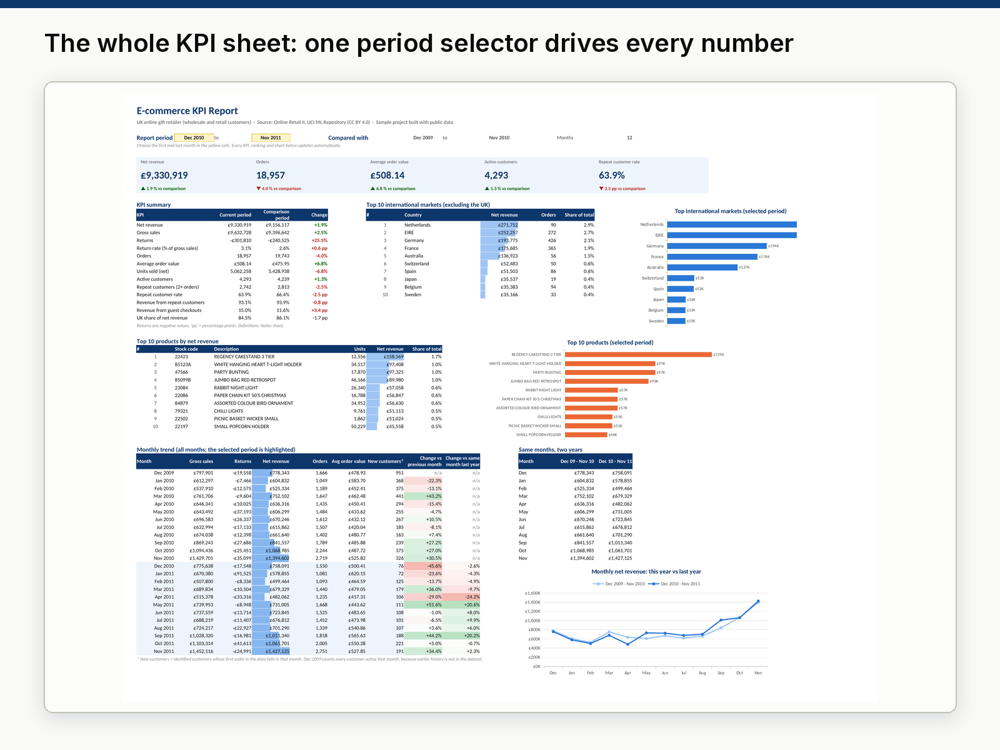

# 01 · Excel KPI Report: e-commerce sales

**Sample project built with public data.** A one-file Excel report that turns 1.07 million raw invoice lines
into a live KPI dashboard: revenue, orders, average order value, repeat customers, top products, top markets and
the monthly trend. Pick a period in two yellow cells and every number, ranking and chart updates.



## Deliverables

| File | What it is |
|---|---|
| [`output/ecommerce_kpi_report.xlsx`](output/ecommerce_kpi_report.xlsx) | The Excel report (KPIs, Data, Customers, Countries, Products, ProductData, Notes). |
| [`output/ecommerce_kpi_report_snapshot.pdf`](output/ecommerce_kpi_report_snapshot.pdf) | Printable snapshot: the KPI sheet on one A3 page plus the Notes sheet. |
| [`output/sql_results.md`](output/sql_results.md) | Bonus: 13 business questions answered with SQL (SQLite), with the results. |
| [`sql/queries.sql`](sql/queries.sql), [`sql/schema.sql`](sql/schema.sql) | The SQL queries and the database schema. |
| [`data/clean/`](data/clean/) | Clean tables (orders, products, customers) and the cleaning log. |

## Key results (Dec 2010 – Nov 2011 vs the previous 12 months)

| KPI | Value | Change |
|---|---|---|
| Net revenue | £9,330,919 | +1.9% |
| Orders | 18,957 | −4.0% |
| Average order value | £508.14 | +6.8% |
| Active customers | 4,293 | +1.3% |
| Repeat customer rate | 63.9% | −2.5 pp |
| Returns (% of gross sales) | 3.1% | +0.6 pp |

- Revenue grew slightly while orders fell: customers placed **fewer but larger orders**.
- The business is very concentrated: the UK brings 84.5% of revenue, and the **top 10% of customers bring 60% of revenue** (SQL Q6).
- The Netherlands, Ireland (EIRE) and Germany are the largest international markets.
- One product (stock code 23166, a storage jar) had 95% of its sales returned: a single order of 74,215 units was cancelled 16 minutes after it was placed (SQL Q9).

## How the workbook works

- **KPIs sheet.** Every value is a live formula on Excel tables: `SUMIFS`, `COUNTIFS`, `INDEX/MATCH`, `LARGE`, `MINIFS`, `EDATE`. No number is typed by hand.
- **Period selector.** The yellow cells (`StartMonth`, `EndMonth`) are named ranges with a drop-down list. The comparison period is the same number of months right before (`EDATE(StartMonth, -NMonths)`).
- **Rankings.** Top 10 markets and products use a helper column (`RankKey`) and `LARGE` + `INDEX/MATCH`, so they re-rank when the period changes.
- **Charts.** Native Excel charts (bar and line) that read the formula cells, so they also update.
- **Conditional formatting.** Green/red for good/bad changes, data bars, a colour scale for month-over-month change and a highlight for the months inside the selected period.
- **Notes sheet.** The definition of each KPI, how it is calculated, the source and licence, the cleaning log and the limitations.
- **Checked.** The file is recalculated in LibreOffice by the build script: 44,001 formulas, 0 errors (#REF!, #DIV/0!, #NAME?, #VALUE!). The main KPIs are also recalculated with pandas and must match.
- The file stores calculated values, so the numbers are visible even in Excel's Protected View.

## Data

| | |
|---|---|
| Dataset | Online Retail II: all transactions of a UK-based online gift-ware retailer, 1 Dec 2009 – 9 Dec 2011. Many customers are wholesalers. |
| Source | UCI Machine Learning Repository, Daqing Chen (2012). DOI [10.24432/C5CG6D](https://doi.org/10.24432/C5CG6D) |
| Licence | [Creative Commons Attribution 4.0 (CC BY 4.0)](https://creativecommons.org/licenses/by/4.0/) |
| Period used | 24 full months, Dec 2009 – Nov 2011 (Dec 2011 has only 9 days) |

The raw file (45 MB) is not stored in this repository: `run.py` downloads it from UCI.

## Cleaning steps

| Rule | Rows removed | Rows after |
|---|---:|---:|
| Load both sheets (2009-2010 and 2010-2011) | – | 1,067,371 |
| Remove exact duplicate lines (includes 1–9 Dec 2010, which appears in both sheets) | 34,335 | 1,033,036 |
| Keep 24 full months (Dec 2009 – Nov 2011) | 25,247 | 1,007,789 |
| Remove non-product codes (postage, fees, manual adjustments, tests, gift vouchers) | 5,724 | 1,002,065 |
| Remove lines with price ≤ 0 (free items, stock write-offs) | 5,911 | 996,154 |
| Upper-case stock codes (173 codes such as `85123a` → `85123A`; Excel lookups ignore case) | 0 | 996,154 |
| One description per stock code; missing customer IDs labelled "Guest" | 0 | 996,154 |

The 996,154 clean lines are grouped into 45,968 invoices (sales and returns) for the `Data` sheet.
Full log: [`data/clean/cleaning_log.csv`](data/clean/cleaning_log.csv).

## SQL bonus

The same clean data is loaded into SQLite (`invoices`, `invoice_lines`, `products`, `customers`) and 13 queries
answer business questions: monthly trend, month-over-month growth (`LAG`), year-over-year totals, top products,
top markets with share of total (`SUM() OVER ()`), revenue concentration by decile (`NTILE`), customer segments,
retention, return rates, weekday pattern, basket size, top customers and products bought together (self-join).

## Reproduce

```bash
python -m venv .venv && .venv/bin/pip install -r ../requirements.txt
.venv/bin/python run.py      # about 5 minutes; needs LibreOffice for the formula check
```

`run.py` downloads the data, cleans it, builds the workbook, recalculates it in LibreOffice (fails on any formula
error), cross-checks the KPIs with pandas, runs the SQL and builds the Upwork images.

## Limitations

- About a fifth of invoice lines have no customer ID ("Guest"). They count for revenue and orders, not for customer KPIs.
- Returns are counted in the month they were processed, not the month of the original sale.
- First-order dates only see history from Dec 2009, so "new customers" are overstated in the first months.
- This is a sample analysis of a public dataset, not a client engagement.
