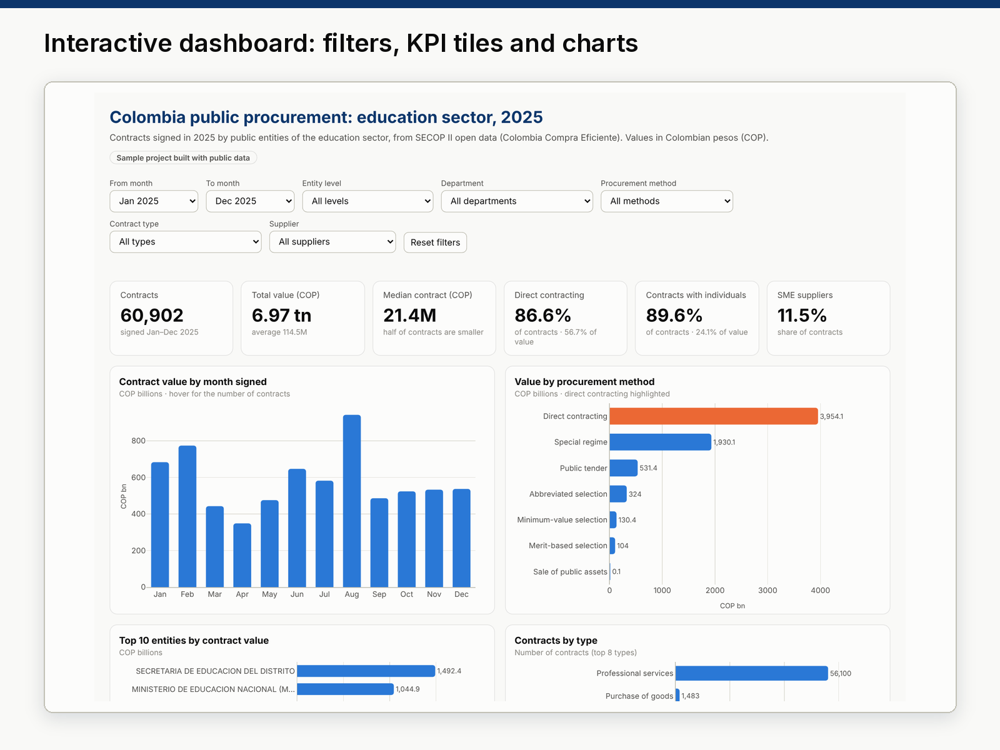

# 02 · Interactive dashboard + Power BI kit: Colombia education procurement, 2025

**Sample project built with public data.** A one-page interactive dashboard of the **60,902 public contracts**
signed in 2025 by Colombia's education-sector entities, pulled from the SECOP II open-data API, plus a ready-to-load
**Power BI kit** (star schema, 12 DAX measures and a build guide).

**Live dashboard:** [`docs/procurement-dashboard/`](../docs/procurement-dashboard/index.html) (published with GitHub Pages)



## Deliverables

| File | What it is |
|---|---|
| [`output/dashboard.html`](output/dashboard.html) | Single-file dashboard (HTML + Plotly.js). Works offline; also published in `docs/`. |
| [`powerbi/data/`](powerbi/data/) | Star schema as CSV: `fact_contracts` + 5 dimensions. |
| [`powerbi/dax_measures.md`](powerbi/dax_measures.md) | 12 DAX measures with explanations. |
| [`powerbi/portfolio_theme.json`](powerbi/portfolio_theme.json) | Power BI theme with the portfolio colours. |
| [`powerbi/POWERBI_PASO_A_PASO.md`](powerbi/POWERBI_PASO_A_PASO.md) | Step-by-step build guide (Spanish). |
| [`powerbi/VALORES_ESPERADOS.md`](powerbi/VALORES_ESPERADOS.md) | Expected values to check the Power BI model. |

## What the dashboard shows

- **Filters (one row, above everything):** month range, entity level, department, procurement method, contract type and supplier type. Every tile, chart and the table re-calculate from the same filtered rows.
- **KPI tiles:** contracts, total value, median contract, share of direct contracting, share of contracts with individuals, share of SME suppliers.
- **Six charts:** value by month, value by procurement method (direct contracting highlighted), top 10 entities, contracts by type, top 10 departments, contract-size distribution.
- **Table view** of the top 15 entities, so no number depends on hovering.
- Responsive (tested at 390 px wide), light and dark mode, no console errors.

## Key findings (contracts signed in 2025)

| Indicator | Value |
|---|---|
| Contracts | 60,902 |
| Total contract value | COP 6.97 trillion |
| Median contract | COP 21.4 million (the average is COP 114.5 million: a few very large contracts pull it up) |
| Direct contracting | 86.6% of contracts, 56.7% of value |
| Competitive methods (tenders, abbreviated, minimum-value and merit-based selection) | 5.4% of contracts, 15.6% of value |
| Contracts with individuals | 89.6% of contracts, 24.1% of value |
| SME suppliers | 11.5% of contracts |

- Most contracts are **professional-service contracts with individuals** (56,100 contracts), signed directly.
- January alone has 14,103 contracts (23% of the year): entities hire most service contractors at the start of the year.
- One entity, Institución Universitaria ITM, signed 19,225 contracts (32% of all contracts) but only 6% of the value.
- Bogotá-based entities account for COP 3.86 trillion, more than half of the value.

## Data

| | |
|---|---|
| Dataset | SECOP II – Contratos Electrónicos ([datos.gov.co/d/jbjy-vk9h](https://www.datos.gov.co/d/jbjy-vk9h)) |
| Publisher | Agencia Nacional de Contratación Pública – Colombia Compra Eficiente |
| Licence | [CC BY-SA 4.0](https://creativecommons.org/licenses/by-sa/4.0/). The derived CSV files in this folder are shared under the same licence. |
| Filter | `sector = 'Educación Nacional'` and `fecha_de_firma` in 2025 (SoQL query in `src/download.py`) |
| Extracted on | 26 Oct 2026 (SECOP II changes daily; re-running gives the latest data) |

**Privacy.** Only organisation-level and contract-level columns are downloaded. Names and ID numbers of people
(individual contractors, legal representatives, supervisors) and bank details are never requested from the API.

## Star schema

`fact_contracts` (one row per contract: keys, signing/start/end dates, supplier type, SME flag, contract value,
paid and invoiced value, duration) related many-to-one to `dim_entity` (495 entities), `dim_date` (2025 calendar),
`dim_modality` (13 SECOP methods grouped into 7, with `is_direct` / `is_competitive` flags), `dim_contract_type`
and `dim_status`. All CSVs use UTF-8, ISO dates and whole numbers (no decimal-separator issues in Power BI).

## Reproduce

```bash
.venv/bin/python run.py     # about 1 minute: download, clean, star schema, dashboard, browser test, images
```

`run.py` also runs `tests/test_dashboard.js` in Chromium: it applies four filter combinations at desktop and phone
width (light and dark mode) and checks that the KPI tiles match the values computed with pandas, that there are no
console errors and that the page never scrolls sideways.

## Limitations

- Values are contract values at signing (plus registered modifications), not payments; paid values are as of the extraction date.
- Sector, level and department come from SECOP and can contain classification errors (for example, some SENA regional offices appear under the education sector).
- 329 contracts have a value of 0; they are counted but do not change totals.
- This is a sample analysis of open data, not an audit or a legal assessment of any contract.
