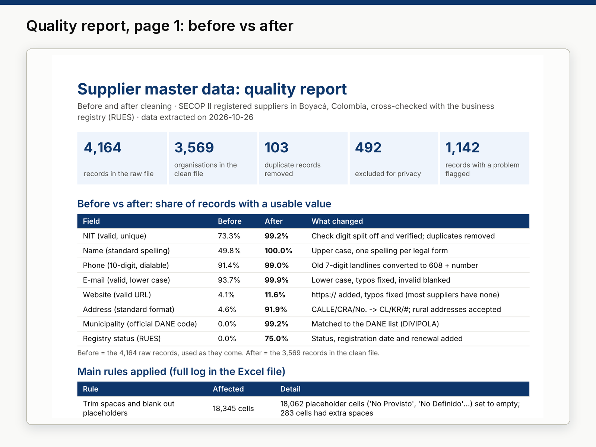

# 03 · Data cleaning, deduplication and validation: supplier master file

**Sample project built with public data.** A real, messy public file — the 4,164 organisations registered as
suppliers in Colombia's SECOP II e-procurement system with an address in Boyacá — cleaned, deduplicated, validated
and cross-checked with the national business registry (RUES). No errors were added for the demo: every problem below
is in the source data.



## Deliverables

| File | What it is |
|---|---|
| [`output/suppliers_clean.xlsx`](output/suppliers_clean.xlsx) | Excel workbook: Summary, Clean data (3,569 organisations), Issues, Cleaning log, Quality before-after (with chart), Data dictionary. |
| [`output/quality_report.pdf`](output/quality_report.pdf) | Two-page before/after quality report with table and chart. |
| [`data/clean/cleaning_log.csv`](data/clean/cleaning_log.csv) | Each rule applied and how many rows or cells it affected. |
| [`data/clean/issues.csv`](data/clean/issues.csv) | One row per problem found (field, issue, action). |
| [`src/rules.py`](src/rules.py) + [`tests/test_rules.py`](tests/test_rules.py) | The validation rules and their unit tests. |

## Results

| | |
|---|---|
| Raw records | 4,164 |
| Clean organisations | 3,569 |
| Duplicate records removed (same tax ID) | 103 |
| Records excluded for privacy (personal ID numbers or person names) | 492 |
| Records with at least one problem flagged for review | 1,142 |
| Legal form corrected using the registry | 157 |
| Active registrations **not renewed for 2026** | 469 |
| Companies in liquidation / registrations cancelled | 55 / 28 |

**Share of records with a usable value, before → after**

| Field | Before | After |
|---|---:|---:|
| NIT (valid, unique) | 73.3% | 99.2% |
| Name (standard spelling) | 49.8% | 100% |
| Phone (10-digit, dialable) | 91.4% | 99.0% |
| E-mail (valid, lower case) | 93.7% | 99.9% |
| Website (valid URL) | 4.1% | 11.6% (most suppliers have no website) |
| Address (standard format) | 4.6% | 91.9% |
| Municipality (official DANE code) | 0% | 99.2% |
| Registry status (RUES) | 0% | 75.0% |

## What was wrong in the raw file, and the rule that fixed it

| Problem found | Rule |
|---|---|
| 18,062 placeholder cells ("No Provisto", "No Definido") and extra spaces | Trim and blank out placeholders |
| Tax IDs typed with the check digit glued on (614), with dots and dashes, or as dummy values (`90001`, `1111…`) | Split NIT and check digit; verify it with the DIAN modulo-11 algorithm; flag the rest |
| 428 records whose "NIT" is a personal ID (cédula) and 64 whose name is a person's name | **Privacy:** excluded; 29 person-like names replaced with the legal name from the registry |
| 103 tax IDs registered more than once | Keep the record with the most contact fields, then the most recent |
| `SAS`, `S.A.S`, `s.a.s.`… in names; company type contradicting the registry (157) | One spelling per legal form; legal form taken from RUES |
| Phones as `7444664`, `098 7447432`, `+57 (8) 7605427`, two numbers in one cell | +57 format; old landlines converted to the 2021 numbering plan (608 + number) |
| E-mails in upper case, with spaces or `gmail.con` | Lower case, typos fixed, invalid blanked; **privacy:** 821 personal-looking mailboxes masked |
| Websites as `www,site.com`, `http//site.com`, e-mails typed as websites | Normalised to `https://…`; invalid blanked |
| Addresses as `Carrera 7 No. 18 - 56`, `CRA`, `CLL`, `N°` | Colombian standard abbreviations: `KR 7 # 18-56` |
| No municipality code; "Güicán" vs the official "Güicán de la Sierra" | DANE code from DIVIPOLA |
| Dates in three formats across the two sources (`2024-03-25T22:44:28.000`, `19971015`, `2026/06/18 11:31:29.553`) | Parsed to ISO dates and range-checked |
| No way to know if a supplier still exists | Cross-check with RUES by NIT: status, registration date, last renewal, "en liquidación" |

Full list with counts: [`data/clean/cleaning_log.csv`](data/clean/cleaning_log.csv) (20 rules).

## Privacy

Only organisations are published. The API queries never request legal representatives' names, IDs, phones or
e-mails. Records identified by a personal ID number, or with a person's name and no registry record, are excluded.
E-mails that are not a role mailbox (info@, ventas@…) and do not contain the organisation's name are masked
(`j*******@gmail.com`), and mobile numbers show only the operator prefix and the last two digits. `run.py` ends with
an automatic privacy check that fails the build if any of these slip through. The raw downloads stay out of git.

## Data

| Dataset | Publisher | Licence |
|---|---|---|
| [SECOP II – Proveedores Registrados](https://www.datos.gov.co/d/qmzu-gj57) | Colombia Compra Eficiente | CC BY-SA 4.0 |
| [RUES – Personas Naturales, Jurídicas y ESAL](https://www.datos.gov.co/d/c82u-588k) | Confecámaras | CC BY-SA 4.0 |
| [DIVIPOLA – municipality codes](https://www.datos.gov.co/d/gdxc-w37w) | DANE | CC BY-SA 4.0 |

Filter: `departamento = 'Boyacá'` and organisation company types (companies, non-profits, cooperatives, consortia,
public bodies). Extracted on 26 Oct 2026. The clean files are shared under CC BY-SA 4.0.

## Reproduce

```bash
.venv/bin/python run.py   # about 1 minute: tests, download, cleaning, Excel, PDF, privacy check, images
```

## Limitations

- The person-name check is a heuristic: it may also remove a few organisations named after a person.
- "Not found in RUES" is common for community action boards, consortia and public bodies, which are registered elsewhere.
- Phones were not called and websites were not visited (project 04 shows website verification).
