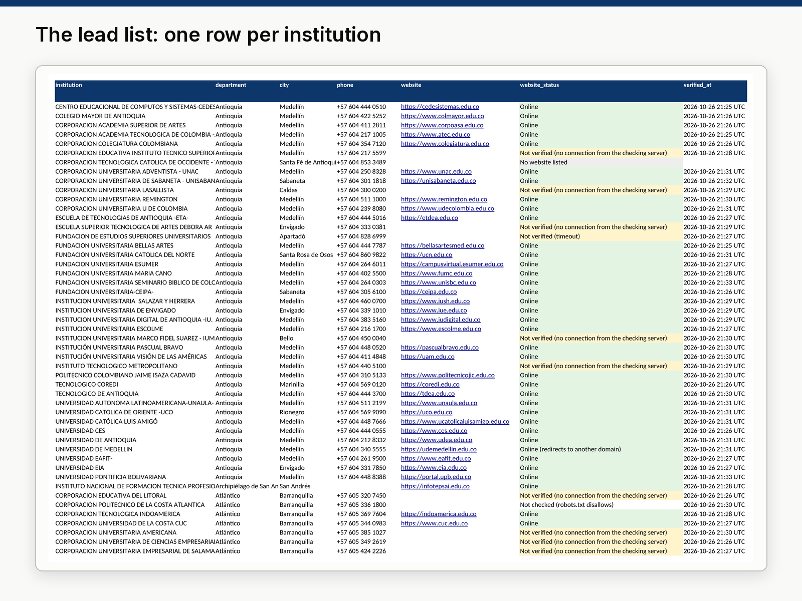

# 04 · Verified B2B lead list: Colombian higher-education institutions

**Sample project built with public data.** A lead list of the 300 universities and colleges in Colombia's official
registry, enriched with enrolment figures and a live check of every website. Each row says where each value comes
from, when the website was checked and what the check found, so a sales team knows which rows to trust.



## Deliverables

| File | What it is |
|---|---|
| [`output/colombia_higher_ed_leads.csv`](output/colombia_higher_ed_leads.csv) | The list, UTF-8 CSV: import it into Google Sheets with *File → Import*. |
| [`output/colombia_higher_ed_leads.xlsx`](output/colombia_higher_ed_leads.xlsx) | The same list in Excel: Summary, Leads (filterable table), Method, Data dictionary. |
| [`output/METHOD.md`](output/METHOD.md) | Sources, each step with its count, how websites were checked and how to read the status column. |
| [`src/verify.py`](src/verify.py) | The website check: robots.txt first, descriptive User-Agent, pauses, home page only. |

## Columns

`institution`, `department`, `city`, `phone` (+57, 2021 numbering plan), `website` (verified home page),
`website_status`, `verified_at` (UTC), `sector`, `institution_type`, `high_quality_accreditation`,
`students_enrolled_2021-1`, `branch_campuses`, `snies_code`, `nit` (tax ID), `legal_nature`, `address`,
`http_status`, `page_title`, `website_listed`, `website_source`, `website_note`, `source`.
Organisation-level data only: no names, e-mails or phone numbers of people.

## Results

| | |
|---|---|
| Institutions (main campus records) | 300, in 27 departments; 122 in Bogotá |
| With a phone in +57 format | 292 |
| With enrolment figures (semester 2021-1) | 278, 1.86 million students in total |
| Websites from the registry / from Wikidata / none | 283 / 2 / 15 |
| Website values corrected (e-mail typed as website, `wwww.`, missing dot) | 6 |
| Websites that answered (status starts with "Online") | **220** (193 online, 14 moved to another domain, 13 online but blocking scripts) |
| Not verified from the checking server (refused, timeout, TLS) | 61, plus 1 whose robots.txt disallows checks |
| Site error (HTTP 5xx) | 3 |

Finding: the 80 institutions with high-quality accreditation are much larger, with a median of 10,407 students
against 1,296 for the rest, so they are a natural first segment for most B2B offers.

**Important:** the check ran from a cloud server outside Colombia, and many Colombian institutional sites refuse
foreign cloud traffic. "Not verified" therefore means "could not be confirmed from here", not "site is down".
Re-run `python run.py --refresh` from a Colombian connection before using those rows.

## Reproduce

```bash
.venv/bin/python run.py            # uses cached website checks (seconds)
.venv/bin/python run.py --refresh  # re-checks every website (several minutes: it pauses between requests)
```

`run.py` downloads the sources, verifies the websites, builds the CSV and Excel, and runs checks: 150-300 rows,
required columns present, no duplicate tax IDs, no e-mail address anywhere, and `website` filled only for rows
whose status is "Online".

## Data and licences

- Ministerio de Educación Nacional, *Instituciones de Educación Superior*, datos.gov.co dataset
  [n5yy-8nav](https://www.datos.gov.co/d/n5yy-8nav), [CC BY-SA 4.0](https://creativecommons.org/licenses/by-sa/4.0/).
- Ministerio de Educación Nacional, *Matrícula estadística de educación superior*, datos.gov.co dataset
  [5wck-szir](https://www.datos.gov.co/d/5wck-szir), CC BY-SA 4.0 (aggregated per institution with the SoQL API).
- [Wikidata](https://www.wikidata.org/) property P856 (official website), [CC0](https://creativecommons.org/publicdomain/zero/1.0/),
  used only when the registry had no usable website.
- The lead list is a derived work and is shared under CC BY-SA 4.0.

## Limitations

The registry records are dated July 2022, so some phones or addresses may have changed. Enrolment is the latest
semester published as open data (2021-1). A site that answers shows the domain is live at that moment, not that the
contact data on it is current.
