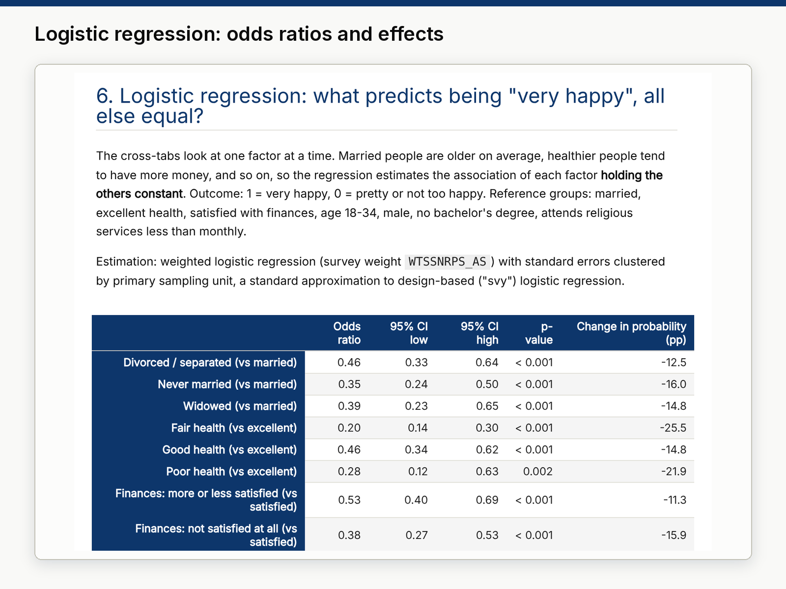

# 05 · Survey analysis: what goes with happiness? (GSS 2024)

**Sample project built with public data.** A complete statistical analysis of a public survey, written the way a
thesis chapter or a research client needs it: sample description, cross-tabulations with chi-square tests,
confidence intervals that respect the survey design, and a logistic regression with its assumptions checked and
the results explained in plain language.



## Deliverables

| File | What it is |
|---|---|
| [`output/report.html`](output/report.html) | The report, for readers (no code). |
| [`output/report.pdf`](output/report.pdf) | The same report as a PDF. |
| [`output/report_with_code.html`](output/report_with_code.html) | The report with every line of code shown. |
| [`analysis/analysis.ipynb`](analysis/analysis.ipynb) | Executed Jupyter notebook. Source: [`analysis/analysis.py`](analysis/analysis.py) (percent-format cells). |
| [`src/survey.py`](src/survey.py) | Design-based estimates: weighted proportions with Taylor-linearised standard errors (strata and PSUs). |
| [`docs/variables.md`](docs/variables.md) | Data dictionary: GSS variable, question wording from the codebook, coding used. |
| [`output/figures/`](output/figures/) | Charts used in the report (PNG). |

## Main results

| | |
|---|---|
| Respondents | 3,986 US adults (3,954 answered the happiness question) |
| Very happy | **23.0%** (95% CI 20.8% to 25.3%) |
| Very happy, by marital status | 32% of married vs 13% of never-married adults |
| Very happy, by health | 41% in excellent health vs 15% in poor health |
| Very happy, by finances | 39% satisfied with finances vs 14% not satisfied at all |
| Chi-square tests (all p < 0.001) | marital status χ²(6) = 211.5, V = 0.16 · health χ²(6) = 338.9, V = 0.21 · finances χ²(4) = 396.2, V = 0.22 |

**Logistic regression** (n = 3,760; outcome: very happy). Holding the other factors constant:

- Never married: −16 percentage points vs married (odds ratio 0.35); divorced or separated −13 points.
- Fair health: −26 points vs excellent health (OR 0.20); poor health −22 points (OR 0.28).
- Not satisfied with finances: −16 points vs satisfied (OR 0.38).
- Religious services monthly or more: +5 points (p = 0.011). A bachelor's degree: −5 points (p = 0.015) once health and finances are held constant. Sex and age group: no clear difference.
- Checks: events per predictor 54, highest VIF 2.02, no dominant influential case, AUC 0.73. The Hosmer-Lemeshow test (p = 0.03) flags some lack of fit, discussed in the report.

These are associations, not causal effects.

## Method

- **Weights and design.** Weight `WTSSNRPS_AS` (the one NORC defines for all 2024 cases). Standard errors by
  Taylor linearisation with variance strata `VSTRAT` and primary sampling units `VPSU`, as Stata `svy` or the R
  `survey` package do. Confidence intervals for shares are computed on the logit scale so they stay between 0 and 1.
- **Chi-square tests** on respondent counts, with Cramér's V and the minimum expected count reported for each table.
- **Logistic regression** with survey weights and standard errors clustered by sampling unit; odds ratios with 95% CIs
  and average marginal effects in percentage points.
- **Assumptions** checked: events per predictor, multicollinearity (VIF), influential observations (Cook's distance),
  calibration by deciles and the Hosmer-Lemeshow test.
- Tools: Python (pandas, statsmodels, scipy, scikit-learn, matplotlib), Jupyter. R and Quarto were not available in
  the build environment; the same analysis maps directly to R's `survey` package.

## Data

General Social Survey 2024 (Release 3a), NORC at the University of Chicago, principal funding from the National
Science Foundation. Downloaded from [gss.norc.org](https://gss.norc.org/us/en/gss/get-the-data.html). The GSS
terms allow use with the citation below; the microdata are **not** redistributed here: `run.py` downloads them.

> Davern, Michael; Bautista, Rene; Freese, Jeremy; Herd, Pamela; and Morgan, Stephen L. General Social Survey
> 1972-2024. [Machine-readable data file]. NORC ed. Chicago, 2026. 1 datafile and 1 codebook (2024 Release 3a).

## Reproduce

```bash
.venv/bin/python run.py   # downloads the data, executes the notebook, exports HTML + PDF, builds the images
```

## Limitations

Cross-sectional and self-reported data; mixed interview modes (web, face-to-face, phone); complete-case analysis;
the regression uses weights with cluster-robust errors, a close approximation to full design-based estimation.
