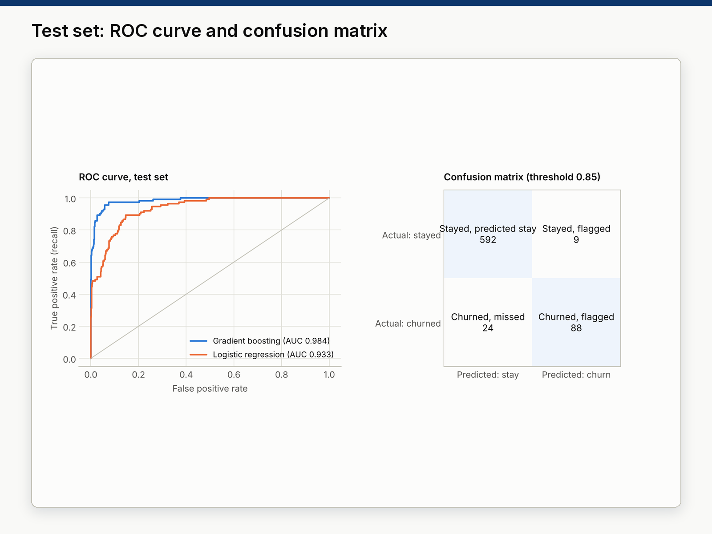

# 06 · Customer churn prediction (telecom)

**Sample project built with public data.** A predictive model that tells a subscription business which customers
are likely to leave in the next quarter, built step by step without data leakage, plus a one-page summary with
five actions for managers.



## Deliverables

| File | What it is |
|---|---|
| [`analysis/churn_model.ipynb`](analysis/churn_model.ipynb) | Executed notebook: exploration → preparation → models → validation → drivers. Source: [`analysis/churn_model.py`](analysis/churn_model.py). |
| [`output/churn_report.html`](output/churn_report.html) | The notebook as a readable report (no code). [`output/churn_model.html`](output/churn_model.html) has the code. |
| [`output/churn_one_pager.pdf`](output/churn_one_pager.pdf) | One page for managers: model quality, drivers, 5 recommendations. |
| [`output/figures/`](output/figures/) | Charts (usage by churn, ROC and confusion matrix, feature importance). |
| [`output/results.json`](output/results.json) | Every metric quoted in the texts. |

## Results

| | |
|---|---|
| Customers | 3,150 rows, **300 exact duplicates removed** → 2,850 unique customers; churn rate 15.6% |
| Cross-validation (5 folds, training set) | Logistic regression ROC-AUC 0.934 / PR-AUC 0.749 · Random forest 0.983 / 0.916 · **Gradient boosting 0.986 / 0.947** |
| Test set (713 unseen customers, used once) | **ROC-AUC 0.984**, PR-AUC 0.940 (logistic baseline 0.933) |
| Decision threshold | 0.85, chosen on out-of-fold training predictions: catch at least 80% of churners with the best precision |
| At that threshold (test) | 88 of 112 churners caught (**recall 79%**); 88 of 97 flagged customers really churned (**precision 91%**); 14% of customers flagged |
| Main drivers | Number of calls, seconds of use, complaints, months subscribed, call failures |

What the data says about who leaves: 83% of customers who complained churned (vs 10%); 48% of non-active
customers (vs 6% of active ones); 35% of the lowest-usage quarter (vs 0% of the highest).

## How leakage is avoided

1. Duplicate rows are removed **before** the train/test split, so no customer appears in both.
2. The test set (25%, stratified) is set aside first and used **once**, at the end.
3. Scaling for logistic regression lives inside a scikit-learn `Pipeline`, so it is re-fitted on each CV fold.
4. The threshold is chosen on **out-of-fold** predictions of the training set, never on the test set.
5. Features describe months 1-9 and the label is month 12 (dataset design), so no feature contains the outcome.
6. `age` (5 values) duplicates `age_group` and is dropped.

## Data

Iranian Churn Dataset (2020), UCI Machine Learning Repository, DOI [10.24432/C5JW3Z](https://doi.org/10.24432/C5JW3Z),
licence [CC BY 4.0](https://creativecommons.org/licenses/by/4.0/). Anonymous customers of a telecom operator;
`run.py` downloads the file from UCI.

## Reproduce

```bash
.venv/bin/python run.py    # about 30 seconds
```

## Limitations

One operator and period; no revenue or retention-cost data (so the threshold uses a recall target, not profit);
the drivers are associations, not causes; with 2,850 customers, scores move by a point or two with another split.
