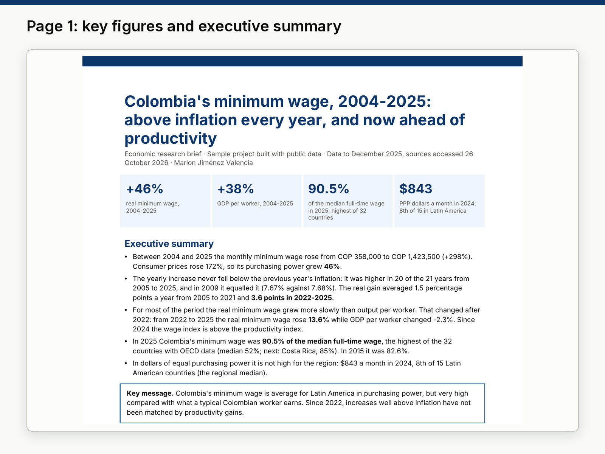

# 07 · Economic research brief: Colombia's minimum wage, 2004-2025

**Sample project built with public data.** A 4-page policy brief that answers three questions with official data:
has the minimum wage kept up with inflation, has it grown faster than productivity, and how does it compare with
other countries? One script downloads every series, processes it and writes the PDF.



## Deliverables

| File | What it is |
|---|---|
| [`output/colombia_minimum_wage_brief.pdf`](output/colombia_minimum_wage_brief.pdf) | The brief: executive summary, context, 4 charts with findings, implications, limitations, method, sources with access date. |
| [`data/clean/colombia_minimum_wage.csv`](data/clean/colombia_minimum_wage.csv) | One row per year: wage, increase, inflation, real wage at 2025 prices, productivity, indexes. |
| [`data/clean/oecd_minimum_to_median.csv`](data/clean/oecd_minimum_to_median.csv), [`latam_minimum_wage_ppp.csv`](data/clean/latam_minimum_wage_ppp.csv) | The two country comparisons. |
| [`data/clean/results.json`](data/clean/results.json) | Every number quoted in the brief. |
| [`src/`](src/) | `download.py` (APIs and files) → `process.py` → `charts.py` → `brief.py`. |

## Findings

| | |
|---|---|
| Nominal minimum wage | COP 358,000 (2004) → COP 1,423,500 (2025), +298%; consumer prices +172% |
| Real minimum wage (annual average CPI) | **+46%** from 2004 to 2025 |
| GDP per person employed (productivity) | +38% from 2004 to 2025 |
| Increase vs previous year's inflation | Higher in 20 of 21 years (2005-2025), equal in 2009; average real gain 1.5 points a year to 2021, **3.6 points in 2022-2025** |
| 2022 → 2025 | Real minimum wage **+13.6%**, GDP per worker −2.3% |
| Minimum wage / median full-time wage, 2025 | **90.5%**, highest of 32 countries with OECD data (median 52%) |
| Minimum wage in 2021 PPP dollars, 2024 | $843 a month, 8th of 15 Latin American countries (regional median) |

Key message: Colombia's minimum wage is average for Latin America in purchasing power but very high compared with
what a typical Colombian worker earns, and since 2022 its real increases have not been matched by productivity.
For 2026 the government decreed COP 1,750,905 (+23.0%, Decreto 1469 de 2025); the brief mentions it as context
only, because 2026 inflation is not complete.

Data check worth noting: ILOSTAT's 2024 PPP values for Ecuador and Uruguay fall by more than 90% from 2023 together
with a change of source. `process.py` detects this kind of series break and leaves those two countries out.

## Reproduce

```bash
.venv/bin/python run.py   # about 30 seconds
```

`run.py` checks that every year from 2003 to 2025 is complete in each source, that the PDF has 3-4 pages with all
required sections, and that the Upwork package meets the size and text limits.

## Sources and licences

- DANE, *Índice de Precios al Consumidor (IPC)*, index series 2003-2026 (Dec 2018 = 100), annex file linked from the
  [DANE IPC page](https://www.dane.gov.co/index.php/estadisticas-por-tema/precios-y-costos/indice-de-precios-al-consumidor-ipc).
  Free reuse citing "Fuente: DANE" ([terms](https://www.dane.gov.co/index.php/terminos-y-condiciones)).
- ILO, [ILOSTAT](https://ilostat.ilo.org/data/), statutory nominal gross monthly minimum wage (DF_EAR_INEE_CUR_NB),
  SDMX API. [CC BY 4.0](https://www.ilo.org/node/9321).
- Presidencia de la República, Decreto 1572 de 2024 (2025 minimum wage, COP 1,423,500; ILOSTAT ends in 2024) and
  Decreto 1469 de 2025 (2026, context only), stored in [`data/manual/minimum_wage_decrees.csv`](data/manual/minimum_wage_decrees.csv).
- World Bank, [World Development Indicators](https://data.worldbank.org/indicator/SL.GDP.PCAP.EM.KD), GDP per person
  employed, constant 2021 PPP $ (SL.GDP.PCAP.EM.KD), API. CC BY 4.0.
- OECD, [Data Explorer](https://data-explorer.oecd.org/), minimum relative to median wages of full-time workers
  (DSD_EARNINGS@MIN2AVE), SDMX API. CC BY 4.0.

Access dates are stored in [`data/clean/sources_accessed.json`](data/clean/sources_accessed.json) and printed in the brief.

## Limitations

Productivity is GDP per person employed, which includes informal work; the real wage depends on the deflator
(annual average CPI here); the OECD ratio uses each country's own wage data; the brief is descriptive and does not
estimate effects on employment or informality.
