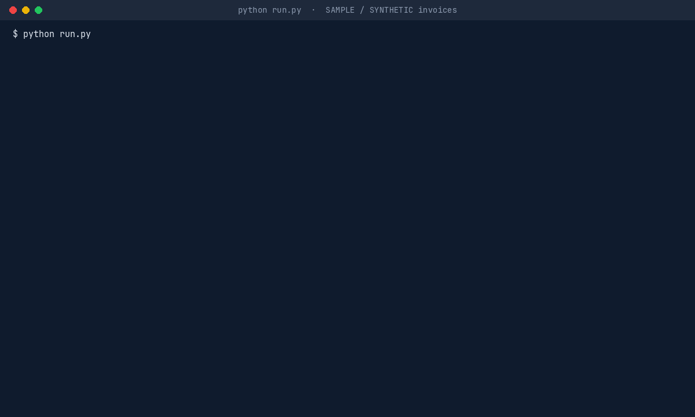
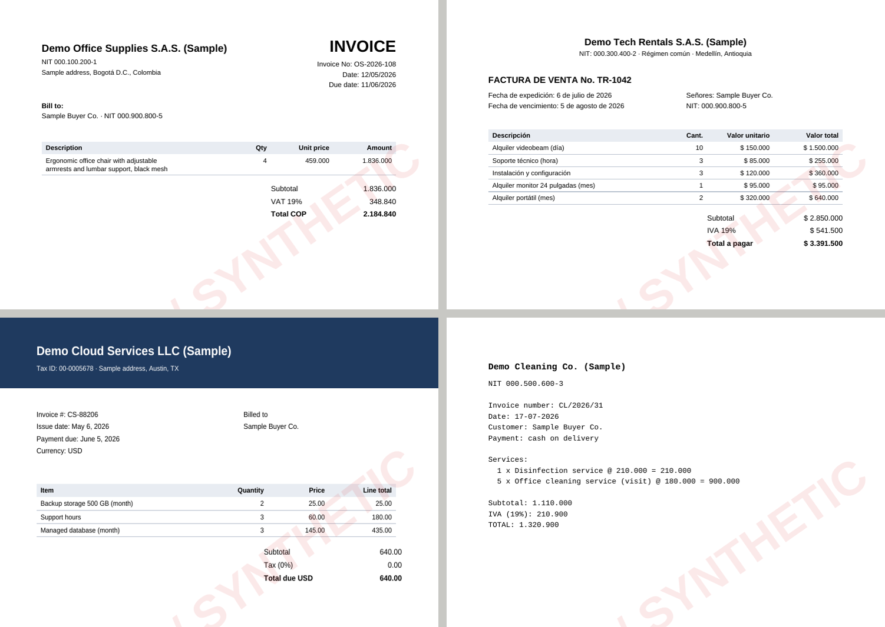

# 08 · AI automation: invoice PDFs to Excel

**Sample project built with public data.** The invoices in this project are **SAMPLE / SYNTHETIC documents**
created by [`src/make_samples.py`](src/make_samples.py): suppliers, buyer, tax IDs (all starting with zeros) and
amounts are invented, every page carries a "SAMPLE / SYNTHETIC" watermark, and every file name starts with `SAMPLE_`.
No real company or person appears in them.

A Python pipeline that turns a folder of supplier invoices (PDF) into an Excel file an accounts-payable team can
load: one row per invoice, one row per line item, and an error log that says what to check before paying. Rules do
the routine work; an optional AI step (Claude) reads what the rules cannot, such as scanned images.



## Deliverables

| File | What it is |
|---|---|
| [`output/invoices_extracted.xlsx`](output/invoices_extracted.xlsx) | Summary, Invoices (status per PDF), Line items, Error log, How it works. |
| [`output/invoices.csv`](output/invoices.csv), [`line_items.csv`](output/line_items.csv), [`error_log.csv`](output/error_log.csv) | The same tables as CSV. |
| [`output/pipeline_run.gif`](output/pipeline_run.gif), [`run_log.txt`](output/run_log.txt) | The console output of a real run, and the resulting sheet. |
| [`data/sample_invoices/`](data/sample_invoices/) | 41 SAMPLE / SYNTHETIC PDFs in 4 layouts, plus the answer key. |
| [`src/`](src/) | `extract.py` (pdfplumber + rules), `validate.py` (checks), `ai_step.py` (optional Claude step), `outputs.py` (Excel/CSV). |
| [`tests/test_pipeline.py`](tests/test_pipeline.py) | Unit tests, including the AI step against a local fake API (no key, no cost). |



## How it works

1. **Read.** pdfplumber reads the text layer. Watermark and stamp characters (large or rotated glyphs) are removed
   first, because they otherwise mix into the text ("VAT 1H9%").
2. **Extract.** Regular-expression rules find each field by its label, in English or Spanish: *Invoice No* /
   *Factura de venta No.*, *Date* / *Fecha de expedición*, *VAT* / *IVA*, and so on. Line items come from table rows
   or from `qty x item @ price = amount` lines; descriptions that wrap onto a second line are joined.
3. **Normalise.** Amounts in either convention (`1.234.567` or `1,234.56`) become numbers; five date formats
   (`12/05/2026`, `17-07-2026`, `2026-03-01`, `May 6, 2026`, `6 de julio de 2026`) become real dates.
4. **Validate.** Required fields; quantity × price on every line; lines vs subtotal; subtotal + tax vs total; tax vs
   rate; due date after issue date; no future dates; no duplicate supplier + invoice number in the batch.
5. **AI step (optional).** Runs only if the `ANTHROPIC_API_KEY` environment variable is set. Invoices the rules could
   not read (scanned images, missing fields) are sent to Claude (structured JSON output); scanned
   PDFs are sent as documents so Claude reads the image. Claude's answer goes through the same checks and is marked
   "AI (Claude)". It is never used to "fix" an invoice that was read correctly but is wrong on paper.
6. **Output.** Excel workbook and CSV files.

## Results on the sample invoices

| | |
|---|---|
| PDFs processed | 41 (4 suppliers × 10, plus one invoice sent twice) |
| OK, ready to load | **36** |
| Flagged for review | 5: one per planted problem (wrong total, wrong line amount, due date before issue date, duplicate, scanned image) |
| Planted problems caught / clean invoices wrongly flagged | **5 of 5 / 0** |
| Accuracy against the answer key | Every field correct in 40 of 41 files; the miss is the scanned image, which has no text for the rules to read |
| Line items extracted | 124 |
| AI step in this run | Not run: no API key was configured. The scanned invoice stays in the error log for manual entry. The step is covered by a unit test against a local fake API. |

## Use it on your own invoices

```bash
.venv/bin/python run.py                         # demo: rebuilds the sample invoices and all outputs
.venv/bin/python run.py --input path/to/pdfs    # your own folder of PDFs -> output/
export ANTHROPIC_API_KEY=...                    # optional: turn on the AI step
.venv/bin/python run.py --input path/to/pdfs --no-ai   # never call the AI step
```

New supplier layouts usually need one more label in `extract.py` (for example a new name for the invoice number).
Until then, those invoices show up in the error log as "Required field not found", or go to the AI step if it is on.

## Limitations

The rules were written for the label families above; a very different layout needs new rules or the AI step. The
answer key exists only because the invoices are synthetic: with real invoices, the validation checks are what catch
reading errors. The AI step sends invoice content to the Anthropic API, so use it only where that is allowed for
the documents being processed.
